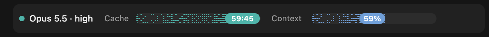
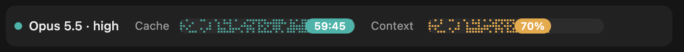
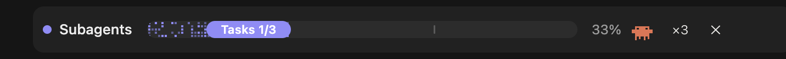

<h1 align="center">Code Visor for Claude</h1>

<p align="center"><code>code-visor</code></p>

<h3 align="center">A heads-up display for Claude Code, right above the prompt.</h3>

<p align="center"><b>Model, prompt cache and context fill, and a live progress bar while subagents work.</b></p>

<p align="center">
  <a href="plugins/code-visor/.claude-plugin/plugin.json"></a>
  <a href="https://claude.com/claude-code"></a>
  
  <a href="LICENSE"></a>
  <a href="https://github.com/lordnikkon/code-visor/stargazers"></a>
</p>

<p align="center">
  <a href="#quick-start">Quick start</a> ·
  <a href="#what-it-shows">What it shows</a> ·
  <a href="#agents-panel">Agents panel</a> ·
  <a href="#commands">Commands</a> ·
  <a href="#configuration">Configuration</a> ·
  <a href="#faq">FAQ</a> ·
  <a href="#documentation">Documentation</a>
</p>

<p align="center"><code>/plugin install code-visor --marketplace lordnikkon/code-visor</code></p>

Code Visor adds one row above the Claude Code prompt that tells you what you would otherwise have to look up: which model and effort you are on, how long the prompt cache stays warm before the next answer has to rebuild it, and how full the context window is. When subagents start, the same row turns into a live progress bar, and an agents panel beside the conversation shows each one with its model, tokens, estimated cost and runtime. It works in the desktop app and on the terminal.



## Quick start

### From the marketplace

Claude Code 2.1.275 and later install it in one step:

```
/plugin install code-visor --marketplace lordnikkon/code-visor
```

On older releases, add the marketplace first:

```
/plugin marketplace add lordnikkon/code-visor
/plugin install code-visor@chvlr
```

Then start a new session. The row appears above the prompt.

### From a clone

```bash
git clone https://github.com/lordnikkon/code-visor.git ~/code-visor
```

For one session:

```bash
claude --plugin-dir ~/code-visor/plugins/code-visor
```

For every session, desktop app included, add the folder to `CLAUDE_CODE_PLUGIN_DIRS` in `~/.claude/settings.json`. Separate several folders with `:`, and append if the variable is already set:

```json
{
  "env": {
    "CLAUDE_CODE_PLUGIN_DIRS": "~/code-visor/plugins/code-visor"
  }
}
```

A `git pull` in the clone updates the mod.

> [!IMPORTANT]
> Code Visor is a **mod**: it runs on Claude Code's function hooks, an API in early access. It is tested against Claude Code 2.1.295, and the API may still change between releases. If the marketplace install does not show up, [load it from a clone](#from-a-clone).

## What it shows

### While you work

| Part | What it shows |
| --- | --- |
| **Model** | The main session's model and effort, e.g. `Opus 5.5 · high`. |
| **Cache** | How long the prompt cache stays warm. Every answer refills the bar to one hour, then it drains: teal, amber below 20 minutes, red below 10, `expired` after the hour. Before the first answer it reads `cold`. On the desktop the fill breathes slowly. |
| **Context** | How full the context window is, the same figure as the status line. Blue, amber from 70 %, red from 85 %. |

Cache and context change colour as they run low or fill up. Here the context has passed 70 % and turned amber:



The row works on the terminal too, drawn with block characters:


### While subagents run

All subagents started by the main session form one batch. The row turns into its progress bar, counting finished agents against started ones, with `×n` to open the [agents panel](#agents-panel):



When the last one has ended, the bar reads **Done**. Ten seconds later model, cache and context return; `✕` dismisses the batch at once.


## Agents panel

A panel beside the conversation lists the subagents of the current batch, running ones first, each with its type, model and effort, context fill, tokens, estimated cost and runtime. Totals for cost, tokens and time sit on top. A repeated task is marked `round 2`, a failed one `error`. **Collapse** switches to one compact line per agent.

Busy agents are drawn as walking crabs; an Explore agent wears a pirate hat and fences with a cutlass. With `prefers-reduced-motion` every animation stands still.

## Commands

| Command | Effect |
| --- | --- |
| `/hud` | Hide or show the HUD row. |
| `/hud demo <minutes>` | Pretend the cache has that many minutes left, to preview the colours. The next answer resets it. |
| `/agents-info` | Open or close the agents panel. |
| `/agents-info open` | Open the panel, or bring it to the front. |

## Configuration

Set the options in `/config` inside Claude Code, or from the shell with `claude plugin configure code-visor@chvlr`.

| Option | Values | Default | Meaning |
| --- | --- | --- | --- |
| `language` | `auto`, `en`, `ru`, `he` | `auto` | Language of row and panel. `auto` follows Claude Code's `language` setting, then the system locale. Hebrew is laid out right to left. |
| `autoOpen` | `subagent`, `session`, `off` | `subagent` | When the agents panel opens by itself: with the session's first subagent, when a session starts, or never. |

The [plugin README](plugins/code-visor/README.md#configuration) shows the `settings.json` form and lists the built-in thresholds.

## FAQ

**How exact is the cost in the panel?**
It is an estimate. Claude Code reports tokens, not money, so the panel prices them with a table of list prices per model (`PRICES` in `hooks/register.tsx`). Cache writes are counted at the one-hour rate a subscription uses.

**Why does the cache countdown start at 60 minutes?**
Claude Code keeps prompt cache entries for one hour after each model request of the main session. The bar restarts with every answer and shows how long you can pause before the next answer has to rebuild the cache.

**The panel did not open by itself on my terminal.**
On a terminal narrower than 144 columns Claude Code holds back a pane that opens unasked, and a toast says so. Your next prompt opens it at any width, as do `/agents-info` and `×n`.

**Nothing shows up after installing.**
Start a new session first. If the row still does not appear, load the mod [from a clone](#from-a-clone); the hooks API it uses is in early access.

## Documentation

| Document | Contents |
| --- | --- |
| [Plugin README](plugins/code-visor/README.md) | Every feature, command and option in detail. |
| [Design notes](docs/code-visor-design.md) | How the mod is built and why. |

### Repository layout

```
.claude-plugin/marketplace.json            marketplace catalog
plugins/code-visor/
  .claude-plugin/plugin.json               plugin manifest and options
  hooks/hooks.json                         names the hooks module
  hooks/register.tsx                       the hooks module
  hooks/*.ts                               pure helpers and tests
  types/index.d.ts                         the $.state contract
docs/code-visor-design.md            how it is built and why
docs/images/                               screenshots used in the READMEs
```

Check changes with `claude plugin test plugins/code-visor`, `claude plugin validate plugins/code-visor` and `claude plugin validate .`.

## License

MIT, see [LICENSE](LICENSE).
